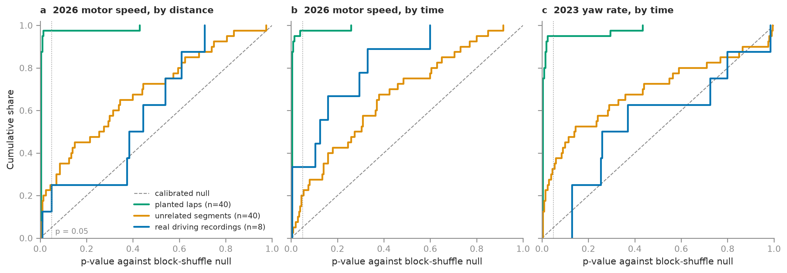
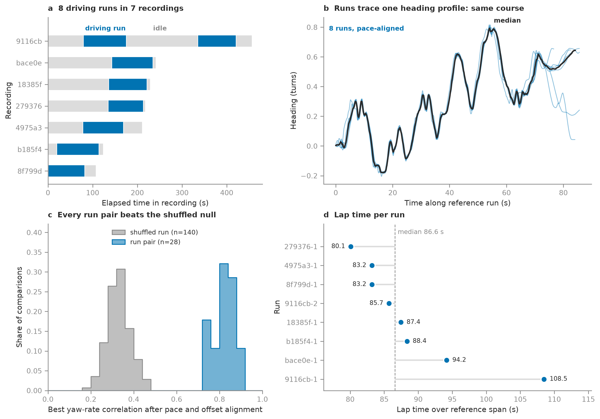

# Lap estimation experiments

> 53.5 logged minutes across 39 recordings; 25 are long enough for recurrence evidence (15 from 2026, 10 from 2023). Eight methods rank seven top-ranked recordings for labeling. Eight 2023 driving runs trace one course, so laps recur across recordings (median aligned lap 86.6 s); a null-calibrated detector finds no lap recurrence inside any recording. No lap is checked against timing truth.

## Lap findings

### 2026

Fusion ranks four of 15 evidence-covered recordings for review, about the top third by construction. Held-out DTW matches the signal-derived period 50% of the time (recording-level bootstrap 0–100%, 16 pairs from three recordings), which is chance. Nine of 13 rank-1 signal periods sit at the search ceiling, and the only cross-recording agreement (five of 11 recordings near 16 s) sits at the 15 s search floor. Against a block-shuffle null, motor speed recurs at p < 0.05 in one of eight driving recordings by distance and three of nine by time, while the same test flags 25% and 20% of unrelated segments, so neither share is distinguishable from false positives. No 2026 lap boundary is verified.



### 2023

Fusion ranks three of 10 evidence-covered recordings for review, again about the top third by construction. Five of eight non-control recordings share a period near 45 s and two more sit near half of it, a likely harmonic, but the calibrated yaw-rate test confirms it in none of eight driving recordings. Eight driving runs segmented from seven recordings trace the same heading profile: pairwise yaw-rate correlation after pace and offset alignment has median 0.83 and minimum 0.73, against a shuffled-run null that peaks at 0.47, and all 28 pairs beat the null. Each recording holds one run (two in the longest), so the lap is the run. Aligned lap times span 80.1–108.5 s, median 86.6 s. Held-out DTW reaches 70% (bootstrap 50–90%, 20 pairs from two recordings), which still includes chance, and elapsed time is inferred at 20 Hz. No 2023 lap is checked against timing truth.



Bottom line: no recording contains repeated laps. In 2023 the lap unit is the run itself and runs align across recordings; 2026 recordings are too short and too thin in channels to tell.

## Immediate impact

1. **Label seven top-ranked recordings next.** Dependency-aware fusion covers 25 recordings and marks four 2026 plus three 2023 sessions; 14 other recordings are too short. Signal and correlation share one autocorrelation and DTW borrows the signal period, so this is one evidence source and a priority order, not a detection count.
2. **Do not trust the signal review flag yet.** It fires on 25% of four controls versus 44% of nine driving recordings in 2026, and on 50% of two controls versus 12.5% of eight in 2023. Its `cycle_count >= 2` gate never rejects because lag is capped at half the duration.
3. **Read learned-model negatives as untuned.** Masked-reconstruction embeddings collapse to effective rank 1.03 of 8 because the encoder pools over time; contrastive (3.3 and 4.3) and autoencoder (4.0 and 6.3) codes do not collapse.
4. **Keep simple baselines.** One untuned autoencoder loses to PCA; one untuned GRU (16 hidden units, 20 epochs, no early stopping) loses to persistence on both held-out cohorts.
5. **Interpolate isolated gaps only.** Short gaps are recoverable enough for sensitivity work. Half-second gaps are unreliable, especially in 2023 inertial signals.
6. **Do not stratify on clusters yet.** One cluster holds 95% of 2026 windows and 67% of 2023 windows and mixes controls with driving.

## What it is

Two separate nine-notebook studies of recurrence and segmentation in Formula SAE telemetry:

- **2026 EV drive day:** 26 source paths, 21 unique SHA256 recordings, 19.8 logged minutes at 10 Hz.
- **2023 AiM event:** 18 unique recordings, 33.7 logged minutes at 20 Hz.

Eight methods run independently: signal processing, DTW, correlation, learned embeddings, autoencoders, contrastive learning, sequence models, and unsupervised clustering. Ninth notebook compares methods and builds family-aware fusion.

Start with [reports/README.md](reports/README.md) for visual summaries, then [reports/findings.md](reports/findings.md) for evidence, interpretation, action, and source separation.

## Notebook order

1. Signal processing
2. Dynamic Time Warping
3. Correlation and cross-correlation
4. Learned embeddings
5. Autoencoders
6. Contrastive learning
7. Sequence models
8. Unsupervised learning
9. Aggregate comparison and fusion report

## Architecture

```text
2023/*.csv                    Drive Day 7_18/**/*.csv
    │                                  │
    └──────────────┬───────────────────┘
                   ▼
          dataset-specific adapters
        recorded 10 Hz | inferred 20 Hz
                   │
                   ▼
       profile → validate → split by recording
                   │
                   ▼
       eight independent experiment runners
                   │
                   ▼
        CSV/JSON/NPY artifacts + PNG diagnostics
                   │
                   ▼
      pairplots → family fusion → report builder
                   │
                   ▼
         reports/README.md + findings.json
```

## Project structure

```text
2023/                         raw 2023 AiM exports
Drive Day 7_18/               raw 2026 CAN exports
lap_estimation/               adapters, experiments, integration, plots, reports
notebooks/aim_2023/           nine executed 2023 notebooks
notebooks/drive_day_2026/     nine executed 2026 notebooks
artifacts/<cohort>/<method>/  metrics, predictions, models, diagnostic PNGs
reports/                      curated findings, profiles, shareable figures
tests/                        data, method, notebook, plotting, reporting contracts
tools/build_notebooks.py      deterministic notebook generator
tools/build_physics_laps.py   null-calibrated distance and heading lap detector
tools/build_reports.py        deterministic findings generator
```

## Reports

- [Report index](reports/README.md)
- [Actionable findings](reports/findings.md)
- [Machine-readable findings](reports/findings.json)
- [2026 cohort profile](reports/profile-2026.md)
- [2023 cohort profile](reports/profile-2023.md)
- [2026 executed comparison](notebooks/drive_day_2026/09_comparison_report.ipynb)
- [2023 executed comparison](notebooks/aim_2023/09_comparison_report.ipynb)

## Data contracts

2026 source timestamps remain unchanged and provide elapsed time directly. Five duplicate files across driver folders remain one recording with multiple aliases; driver attribution stays ambiguous.

2023 source `Time` fields are blank. Adapter validates metadata, units, row width, sample rate, and declared duration, then generates `elapsed_s = sample_index / 20` in memory. Raw CSVs stay unchanged. Wheel-speed channels are constant zero; `VerticalAcc` carries a large uncorrected offset.

Cohorts never pool observations or raw scores. Recording-level splits prevent overlapping windows from leaking across train, validation, and test.

## Run

```powershell
python -m venv .venv
.venv\Scripts\python.exe -m pip install -r requirements.txt
.venv\Scripts\python.exe tools\build_notebooks.py
.venv\Scripts\python.exe tools\build_physics_laps.py
.venv\Scripts\python.exe tools\build_reports.py
.venv\Scripts\python.exe -m unittest discover -s tests -v
```

Run generated notebooks from repository root or either cohort notebook folder. Notebook 9 reads completed artifacts without retraining.

## Evidence limit

No independent lap boundaries, start-line beacon, GPS position, or official timing truth exist. Outputs are ranked review candidates, representation diagnostics, and unvalidated clusters. None are verified laps.

The physics detector's block-shuffle null is optimistic: it flags 20–32% of unrelated real segments at a nominal 5%, so its p-values are upper bounds on evidence. Methods 1-8 carry no null calibration, use one fixed recording split with two to five held-out recordings per cohort, and never use the validation split for selection.

Interpolation never extrapolates or creates higher-frequency information. RPM integration gives shaft revolutions, which are proportional to distance under fixed gearing; the scale is unknown without gear ratio and tire radius, and wheel slip is ignored. Electrical integration is an energy proxy. Yaw and acceleration integrals are drift-prone relative-motion proxies.
