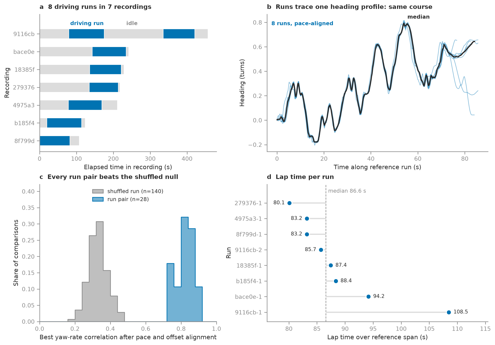
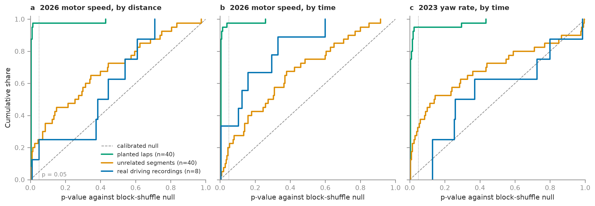
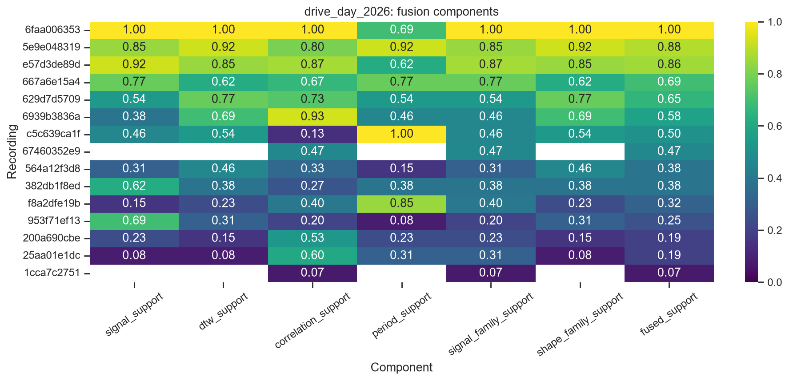
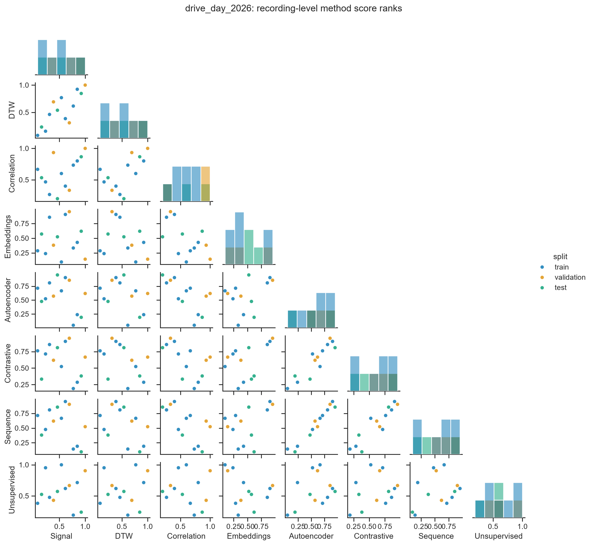
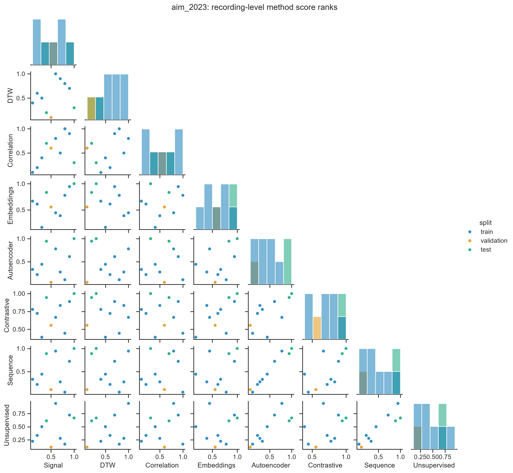
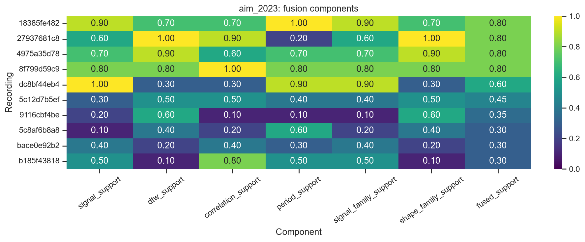

# Lap-estimation reports

> 53.5 logged minutes across 39 recordings; 25 are long enough for recurrence evidence (15 in 2026 EV drive day, 10 in 2023 AiM event). No lap is verified. Recurrence scores are uncalibrated rankings, and 5 negative results come from untuned or uncalibrated configurations.

## Immediate impact

1. **Label 7 top-ranked recordings first.** Fusion ranks 25 evidence-covered recordings from 39 total and selects about the top third by construction: 4 from 2026 EV drive day and 3 from 2023 AiM event. This is a priority order, not a detection count.
2. **Do not trust the signal review flag yet.** It fires on controls about as often as on driving. 2026 EV drive day: 25.0% of 4 control recordings versus 44.4% of 9 non-control recordings; 2023 AiM event: 50.0% of 2 control recordings versus 12.5% of 8 non-control recordings.
3. **Read learned-model negatives as untuned.** Effective rank — 2026 EV drive day: masked 1.03, contrastive 3.31, autoencoder 4.01 of 8; 2023 AiM event: masked 1.03, contrastive 4.34, autoencoder 6.28 of 8. Only the masked encoder collapses, and its pooling makes that architectural.
4. **Keep PCA and persistence.** Current autoencoder and GRU configurations lose to those baselines on held-out recordings.
5. **Repair isolated missing samples only.** 0.5 s gaps define current long-gap stress tests and remain unsuitable for inventing missing dynamics.
6. **Do not stratify on clusters yet.** One cluster holds 95% and 67% of windows across cohorts and mixes controls with driving.



*Eight 2023 driving runs, one per recording except the longest, trace the same heading profile once pace is aligned. Laps recur across recordings.*



*Inside a recording, real driving is not distinguishable from unrelated segments, and the block-shuffle null runs optimistic: unrelated segments sit above the calibrated diagonal.*

## Evidence at a glance

| Cohort | Recordings | Long enough for recurrence | Fusion coverage | Source paths | Logged minutes | Clock | Top-ranked for review |
|---|---:|---:|---:|---:|---:|---|---:|
| 2026 EV drive day | 21 | 15 | 15 | 26 | 19.8 | recorded_time_column | 4 |
| 2023 AiM event | 18 | 10 | 10 | 18 | 33.7 | inferred_uniform_from_metadata | 3 |

## Lap findings

- **2026 EV drive day:** fusion ranks 4 of 15 evidence-covered recordings for review, about a third by construction. Held-out DTW match rate is 50.0% (95% recording-level bootstrap 0%–100%; 16 pairs from 3 recordings; includes 50% chance). 5 of 11 non-control recordings carry a signal or correlation period within 10% of 16.0 s; that period sits at the 15 s search floor, so it is a likely artifact. Signal flag fires on 25.0% of 4 control recordings versus 44.4% of 9 non-control recordings. Calibrated physics detector: Distance domain: 1 of 8 driving recordings reach p < 0.05 (1 after false-discovery control, 3 at the search ceiling); benchmark recovers 98% of tiled laps and flags 25% of unrelated segments over 40 trials. Time domain: 3 of 9 driving recordings reach p < 0.05 (3 after false-discovery control, 3 at the search ceiling); benchmark recovers 98% of tiled laps and flags 20% of unrelated segments over 40 trials. No lap is verified against timing truth.
- **2023 AiM event:** fusion ranks 3 of 10 evidence-covered recordings for review, about a third by construction. Held-out DTW match rate is 70.0% (95% recording-level bootstrap 50%–90%; 20 pairs from 2 recordings; includes 50% chance). 5 of 8 non-control recordings carry a signal or correlation period within 10% of 45.3 s; 2 more sit near half that period, a likely harmonic. Signal flag fires on 50.0% of 2 control recordings versus 12.5% of 8 non-control recordings. Calibrated physics detector: Time domain: 0 of 8 driving recordings reach p < 0.05 (0 after false-discovery control, 0 at the search ceiling); benchmark recovers 95% of tiled laps and flags 32% of unrelated segments over 40 trials. Across recordings: 8 driving runs segmented from 7 recordings trace one course: pairwise yaw-rate correlation after pace and offset alignment has median 0.83 and minimum 0.73, against a shuffled-run null with 95th percentile 0.42 and maximum 0.47 over 140 draws; 100% of 28 pairs beat the null. Aligned lap times span 80.1-108.5 s, median 86.6 s. No lap is verified against timing truth.

Bottom line: 2023 laps are whole runs that repeat across recordings; no recording in either cohort contains repeated laps, and no lap is checked against timing truth.

## 2026 EV drive day





[Cohort profile](profile-2026.md) · [Executed comparison notebook](../notebooks/drive_day_2026/09_comparison_report.ipynb)

## 2023 AiM event





[Cohort profile](profile-2023.md) · [Executed comparison notebook](../notebooks/aim_2023/09_comparison_report.ipynb)

## Findings

[Read evidence, interpretation, and actions](findings.md). Machine-readable copy: [`findings.json`](findings.json).

## Run

```powershell
.venv/Scripts/python.exe tools/build_notebooks.py
.venv/Scripts/python.exe tools/build_physics_laps.py
.venv/Scripts/python.exe tools/build_reports.py
.venv/Scripts/python.exe -m unittest discover -s tests -v
```
